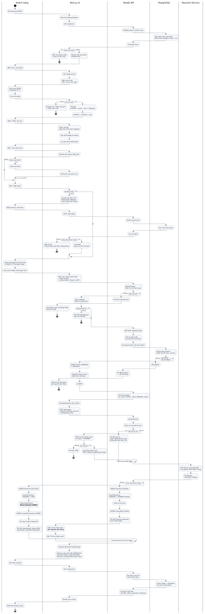
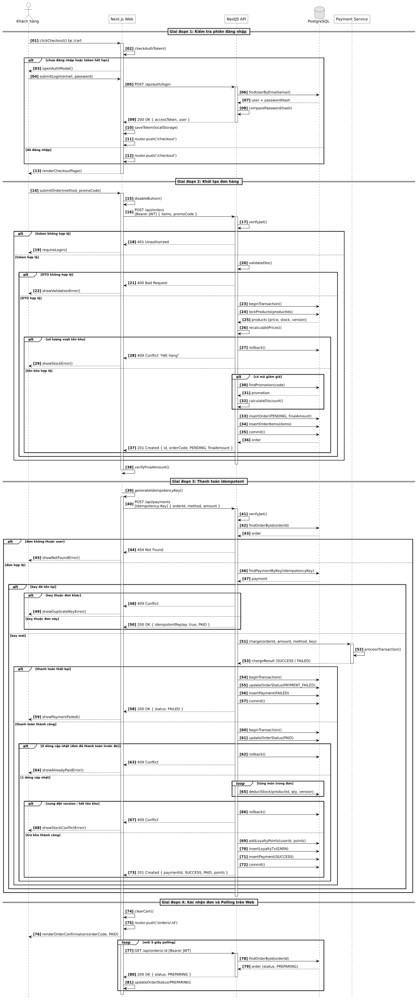
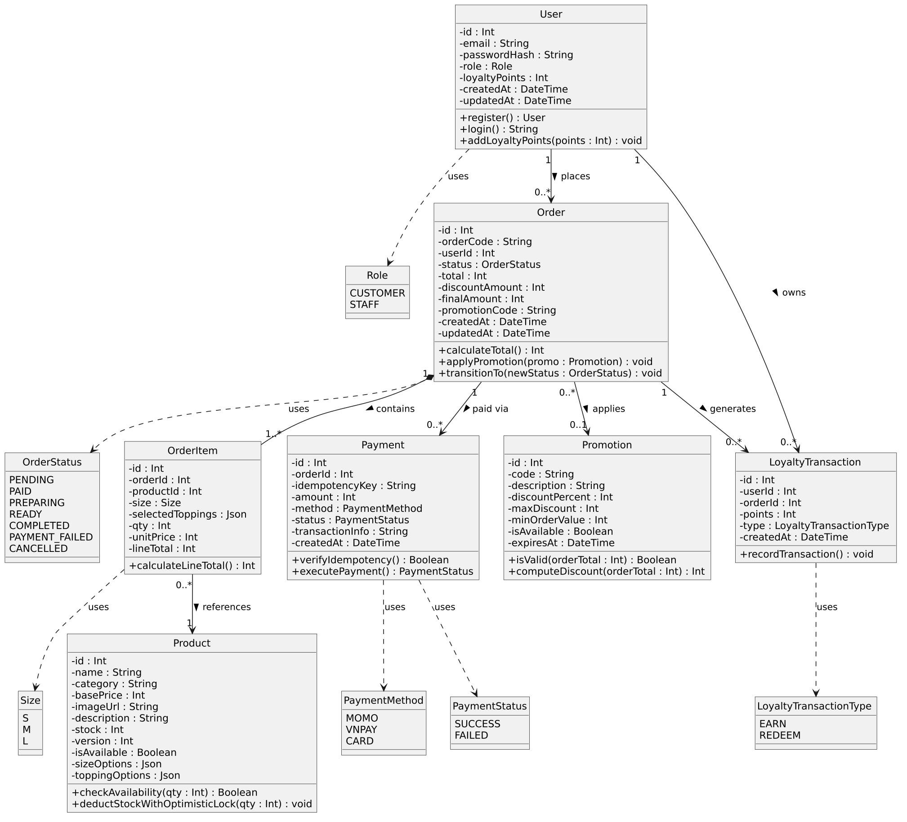

# Task 2 – Mô Hình Hóa Hệ Thống (System Modeling)

| Thông tin | Chi tiết |
| :--- | :--- |
| **Giai đoạn** | Task 2 – Mô hình hóa hệ thống (Assignment 2) |
| **Tài liệu** | `docs/diagrams/README.md` |
| **Công cụ** | PlantUML (nguồn `.puml`) & Kết xuất vector (`.svg` / `.png`) |
| **Người thực hiện** | Nhóm BrewLite (Task 2) |
| **Quy chuẩn** | UML 2.5, phù hợp 100% với SRS (`docs/requirements/srs.md`) và CSDL Prisma |

---

## 1. Task 2.1 – Biểu Đồ Hoạt Động (Activity Diagram - ACT-01)

Sơ đồ mô hình hóa toàn bộ chuỗi nghiệp vụ mua hàng và thanh toán đầu-cuối (*End-to-End Workflow*), phân chia trách nhiệm qua **5 Swimlanes**:
1. **Khách hàng (Customer):** Thực hiện tương tác, lựa chọn sản phẩm, đăng nhập và xác nhận thanh toán.
2. **Giao diện Next.js (Web UI):** Quản lý giỏ hàng phía Client (`localStorage`), điều hướng và hiển thị các trạng thái giao diện (Loading skeleton, Empty, Error).
3. **Backend NestJS API:** Xử lý xác thực JWT, validate DTO đầu vào, điều phối nghiệp vụ và kiểm soát giao dịch.
4. **Cơ sở dữ liệu PostgreSQL:** Lưu trữ dữ liệu quan hệ, thực thi ACID Transaction, khóa bi quan/lạc quan và kiểm soát số lượng tồn kho.
5. **Cổng thanh toán (Payment Service):** Xử lý giao dịch Ví/Thẻ mô phỏng, phản hồi kết quả và hỗ trợ cơ chế Idempotency.

### Xử lý 3 kịch bản bắt buộc theo yêu cầu đề bài:
- **Trường hợp chưa đăng nhập:** Giao diện mở popup hoặc điều hướng sang màn hình đăng nhập/đăng ký, **bảo toàn nguyên vẹn giỏ hàng** hiện tại. Sau khi xác thực thành công, tự động quay lại màn hình thanh toán.
- **Trường hợp hết hàng (Stock Out):** Khi kiểm tra tồn kho phát hiện không đủ số lượng, hệ thống lập tức hủy bỏ giao dịch (Rollback), trả về mã lỗi HTTP 409 Conflict, thông báo rõ món đã hết và giữ nguyên giỏ hàng.
- **Trường hợp thanh toán thất bại:** Ghi nhận bản ghi `Payment` trạng thái `FAILED`, chuyển trạng thái đơn sang `PAYMENT_FAILED`, hoàn trả lại số lượng tồn kho đã tạm khóa, giữ nguyên giỏ hàng và cung cấp nút "Thử lại thanh toán".

*(Mã nguồn: [`activity-checkout.puml`](activity-checkout.puml) · Bản ảnh raster: [`activity-checkout.png`](activity-checkout.png))*

---

## 2. Task 2.2 – Biểu Đồ Trình Tự (Sequence Diagram - SEQ-01)

Sơ đồ mô hình hóa tương tác theo trục thời gian cho use-case trọng tâm **"Đặt và thanh toán đơn hàng" (UC-01 / UC-07)** trong kiến trúc **Ứng dụng Web (Web Client - Next.js App Router / PWA)** giao tiếp với **Backend API (NestJS)**, **CSDL (PostgreSQL)** và **Cổng thanh toán (Payment Service)** với đầy đủ **5 Lifelines**:

$$\text{Khách hàng (Customer)} \longrightarrow \text{Trình duyệt Web (Next.js)} \longrightarrow \text{Backend API (NestJS)} \longrightarrow \text{CSDL (PostgreSQL)} \longrightarrow \text{Payment Service}$$

### Các giai đoạn nghiệp vụ trên nền tảng Web:
1. **Giai đoạn 1: Điều hướng Giỏ hàng & Kiểm tra Phiên đăng nhập (Web Session & Auth Guard):**
   - Khách bấm nút *"Tiến hành thanh toán"* tại trang `/cart` trên trình duyệt.
   - Next.js Client kiểm tra `accessToken` trong `localStorage` (thông qua `authStore`).
   - Nếu chưa đăng nhập / token hết hạn: hiển thị `AuthModal` ngay trên Web (bảo toàn nguyên vẹn giỏ hàng), gửi `POST /api/auth/login`, nhận JWT lưu vào `localStorage`, đóng modal và điều hướng sang trang `/checkout`.
2. **Giai đoạn 2: Khởi tạo Đơn hàng (Order Creation & Stock Check):**
   - Tại trang `/checkout`, khách chọn phương thức thanh toán, bấm *"Xác nhận thanh toán"*. Trình duyệt lập tức vô hiệu hóa nút bấm (`disabled` + loading spinner) chống click đúp (*double-click*).
   - Client gửi `POST /api/orders` kèm Header `Authorization: Bearer <JWT>`.
   - API thẩm định qua `JwtAuthGuard` và `ValidationPipe`, mở DB Transaction: tính lại giá server-side, kiểm tra tồn kho (`stock`), áp mã giảm giá (nếu có), tạo `Order` trạng thái `PENDING` và commit. Nếu thiếu hàng, rollback và trả `409 Conflict`.
3. **Giai đoạn 3: Thanh toán Idempotent (Idempotent Payment & State Machine):**
   - Trình duyệt Web sinh khóa duy nhất `idempotencyKey = crypto.randomUUID()` và gửi `POST /api/payments` kèm Header `Idempotency-Key`.
   - Backend xác thực quyền sở hữu đơn hàng của user, tra cứu `idempotencyKey`. Nếu gặp lại cùng một key đã thành công trước đó, trả về kết quả cũ (*Idempotency Replay Hit*), không charge lần 2.
   - Nếu key mới: gọi cổng thanh toán (hỗ trợ cờ mô phỏng `simulateFailure`).
     - **Thanh toán thất bại:** Cập nhật đơn sang `PAYMENT_FAILED`, lưu payment `FAILED`, phản hồi 200/201. Giao diện Web hiển thị banner lỗi, giữ nguyên giỏ hàng trong `localStorage`, cho phép đổi phương thức hoặc bấm *"Hủy đơn"* (`POST /api/orders/:id/cancel`).
     - **Thanh toán thành công:** Mở DB Transaction, chuyển trạng thái đơn sang `PAID` (kiểm tra điều kiện chống race condition), trừ kho bằng **Optimistic Locking** (`version = version + 1`), tích điểm loyalty cho khách hàng, lưu `Payment` SUCCESS và commit.
4. **Giai đoạn 4: Xác nhận Biên nhận & Polling Trạng thái trên Web:**
   - Next.js Client xóa sạch giỏ hàng trong trình duyệt (`cartStore.clearCart()`) và điều hướng URL sang `/orders/:id`.
   - Trang `/orders/:id` hiển thị biên nhận thanh toán, mã đơn `#ORD-XXXXXX` và tích điểm thưởng.
   - Thiết lập chu kỳ **Client-side Polling (Web interval mỗi 5 giây)** gửi `GET /api/orders/:id` để tự động cập nhật tiến trình pha chế của Barista (`PAID` $\rightarrow$ `PREPARING` $\rightarrow$ `READY`) mà không yêu cầu khách phải bấm tải lại trang (F5).

*(Mã nguồn: [`sequence-checkout.puml`](sequence-checkout.puml) · Bản ảnh raster: [`sequence-checkout.png`](sequence-checkout.png))*

---

## 3. Task 2.3 – Biểu Đồ Lớp Miền (Domain Class Diagram - CLASS-01)

Biểu đồ lớp mức miền mô hình hóa cấu trúc dữ liệu cốt lõi của hệ thống, phản ánh chính xác 100% lược đồ CSDL trong `apps/api/prisma/schema.prisma`:

### Các thực thể chính:
- **`User`:** Tài khoản người dùng (ID, Email, PasswordHash, Role, LoyaltyPoints). Quan hệ 1..* với `Order`.
- **`Product`:** Thông tin món (Tên, Đơn giá cơ sở, Hình ảnh, Tồn kho `stock`, phiên bản `version` phục vụ Optimistic Locking).
- **`Order`:** Đơn hàng (Mã đơn, Trạng thái `OrderStatus`, Tổng tiền, Khóa `idempotencyKey`). Quan hệ 1..* với `OrderItem`, 0..* với `Payment`.
- **`OrderItem`:** Chi tiết từng món trong đơn (Size đã chọn, danh sách Topping, Số lượng, Đơn giá lịch sử tại thời điểm đặt).
- **`Payment`:** Giao dịch thanh toán (Mã giao dịch, Phương thức `PaymentMethod`, Trạng thái `PaymentStatus`, Idempotency Key).
- **`Promotion`:** Chính sách voucher giảm giá (Mã code, Tỷ lệ giảm, Giá trị đơn tối thiểu, Hạn dùng).
- **`LoyaltyTransaction`:** Lịch sử biến động điểm thưởng thành viên (Số điểm, Loại giao dịch `EARN` / `REDEEM`).

### Các kiểu dữ liệu liệt kê (Enumerations):
- `OrderStatus`: `PENDING`, `PAID`, `PREPARING`, `READY`, `COMPLETED`, `PAYMENT_FAILED`, `CANCELLED`.
- `PaymentMethod`: `WALLET`, `CARD`, `VNPAY`.
- `PaymentStatus`: `SUCCESS`, `FAILED`.
- `Role`: `CUSTOMER`, `STAFF`.

*(Mã nguồn: [`class-domain.puml`](class-domain.puml) · Bản ảnh raster: [`class-domain.png`](class-domain.png))*

---

## 4. Đối Chiếu Tính Nhất Quán (Consistency Validation)

- **Tính nhất quán giữa Sơ đồ và SRS:** Mọi thuộc tính và mã trạng thái trên sơ đồ đều khớp 100% với danh mục yêu cầu trong `docs/requirements/srs.md`.
- **Tính nhất quán với Mã nguồn & CSDL:** Các trường dữ liệu, mối quan hệ thực thể và luồng transaction phản ánh đúng hiện thực của NestJS Prisma backend.
- **Lưu trữ chuẩn quy cách:** 100% sơ đồ đều lưu đầy đủ cả tệp nguồn PlantUML (`.puml`) và tệp đồ họa vector (`.svg`), sẵn sàng cho việc đóng gói báo cáo và nghiệm thu.
