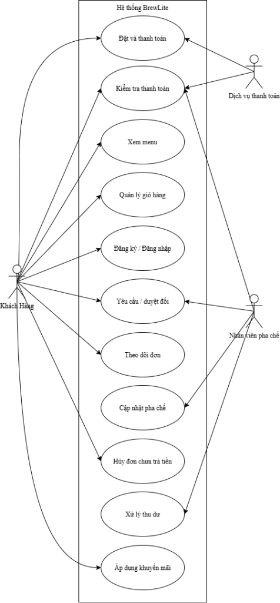

# Task 1.2 – Yêu cầu chức năng và phi chức năng (SRS summary)

- **Dự Án:** BrewLite - Hệ thống Đặt và Thanh toán Đồ uống Trực tuyến
- **Giai đoạn:** Đặc tả Yêu cầu Phần mềm (Task 1.2)
- **Tài liệu:** `docs/requirements/srs.md`
- **Người thực hiện:** Nam
    - Yêu cầu chức năng
    - Yêu cầu phi chức năng
    - Phân loại mức ưu tiên MoSCoW
    - Quy tắc nghiệp vụ (BR)
    - Sơ đồ  use-case tổng quát của toàn hệ thống
- **Liên kết:** [Bối cảnh và Phạm vi (Task 1.1)](./context-and-scope.md)
---
# 0. Quy Ước

## 0.1 Mã định danh

| Tiền tố  | Ý nghĩa                                            | Ví dụ     |
| -------- | -------------------------------------------------- | --------- |
| `FR-xx`  | Functional Requirement – yêu cầu chức năng         | `FR-05`   |
| `NFR-xx` | Non-Functional Requirement – yêu cầu phi chức năng | `NFR-01`  |
| `UC-xx`  | Use-case                                           | `UC-01`   |
| `US-xx`  | User Story                                         | `US-01`   |
| `AC-xx`  | Acceptance Criteria (tiêu chí chấp nhận)           | `AC-05-1` |
| `ST-xx`  | Stakeholder                                        | `ST-01`   |

## 0.2 Thang ưu tiên MoSCoW

| Mức        | Ý nghĩa                                     | Xử lý khi thiếu thời gian               |
| ---------- | ------------------------------------------- | --------------------------------------- |
| **Must**   | Bắt buộc có để MVP hợp lệ                   | Không cắt; phải làm trước               |
| **Should** | Rất quan trọng, cắt được nếu bị ép deadline | Cắt sau, ghi vào backlog Sprint kế tiếp |
| **Could**  | Có thì tốt, không có cũng chạy              | Cắt được ngay                           |
| **Won't**  | Ngoài phạm vi lần này                       | Xem §3.2 `context-and-scope.md`         |

---
# 1. Yêu Cầu Chức Năng

#### FR-01: Duyệt danh mục đồ uống (Menu Browsing)
- **Mô tả:** Hệ thống cung cấp danh sách sản phẩm đồ uống đang kinh doanh, phân tách theo danh mục (Cà phê, Trà, Đá xay...) kèm hình ảnh, đơn giá cơ sở và trạng thái còn hàng.
- **Mức ưu tiên:** Must Have.
- **Endpoint:** `GET /products`
- **Tiêu chí chấp nhận (Acceptance Criteria):**
  - `AC-01-1`: Phản hồi HTTP 200 kèm danh sách mảng JSON, mỗi phần tử chứa đầy đủ các trường: `id`, `name`, `price` (số nguyên $\ge 0$), `category`, `imageUrl`, `isAvailable`, `stock`. `(T)`
  - `AC-01-2`: Đối với sản phẩm có `stock = 0` hoặc `isAvailable = false`, hệ thống tự động gắn nhãn "Hết hàng" và vô hiệu hóa nút thêm vào giỏ. `(T)`
  - `AC-01-3`: Giao diện hiển thị ở định dạng lưới (Grid), tự động co giãn tối ưu trên màn hình di động (tối thiểu 360px) không phát sinh lỗi tràn ngang. `(M)`
  - `AC-01-4`: Hiển thị trạng thái Skeleton loading trong thời gian chờ phản hồi và trạng thái Empty View khi danh mục không có dữ liệu. `(M)`
#### FR-02: Xem chi tiết và Tùy biến món (Product Customization)
- **Mô tả:** Cho phép khách hàng xem mô tả chi tiết nguyên liệu, chọn kích cỡ (Size S/M/L) và các loại topping đi kèm; hệ thống tự động cập nhật đơn giá theo cấu hình.
- **Mức ưu tiên:** Must Have.
- **Endpoint:** `GET /products/:id`
- **Tiêu chí chấp nhận:**
  - `AC-02-1`: Phản hồi HTTP 200 với chi tiết sản phẩm; trả về HTTP 404 Not Found nếu định danh `id` không tồn tại trong CSDL. `(T)`
  - `AC-02-2`: Cho phép chọn duy nhất 1 kích cỡ chuẩn trong danh mục `{S, M, L}` với đơn giá chênh lệch được cộng dồn chính xác vào giá gốc. `(T)`
  - `AC-02-3`: Cho phép chọn đồng thời nhiều loại topping; đơn giá hiển thị trên giao diện cập nhật ngay lập tức theo công thức: $P_{\text{total}} = P_{\text{base}} + \Delta P_{\text{size}} + \sum P_{\text{topping}}$. `(T)`

#### FR-03: Quản lý giỏ hàng cục bộ (Client-side Cart Management)
- **Mô tả:** Khách hàng có thể thêm món tùy biến vào giỏ hàng, cập nhật số lượng, xóa sản phẩm và theo dõi tổng tiền tạm tính. Trạng thái giỏ hàng được duy trì liên tục qua phiên duyệt web.
- **Mức ưu tiên:** Must Have.
- **Tiêu chí chấp nhận:**
  - `AC-03-1`: Nếu thêm cùng một sản phẩm với cùng cấu hình (size, topping) đã có trong giỏ, hệ thống chỉ cộng dồn số lượng mà không tạo dòng mới. `(T)`
  - `AC-03-2`: Nếu số lượng điều chỉnh về 0, hệ thống tự động xóa mục tương ứng ra khỏi giỏ sau khi yêu cầu xác nhận. `(T)`
  - `AC-03-3`: Toàn bộ nội dung giỏ hàng được lưu trữ liên tục vào `localStorage`, bảo đảm không bị mất dữ liệu khi người dùng tải lại trang hoặc vô tình đóng trình duyệt. `(M)`

#### FR-04: Đăng ký tài khoản khách hàng (User Registration)
- **Mô tả:** Cho phép người dùng mới thiết lập tài khoản thông qua thông tin Email, Mật khẩu, Họ tên và Số điện thoại.
- **Mức ưu tiên:** Must Have.
- **Endpoint:** `POST /auth/register`
- **Tiêu chí chấp nhận:**
  - `AC-04-1`: Mật khẩu người dùng được băm an toàn bằng thuật toán `bcrypt` (với cost factor = 10) trước khi lưu vào CSDL; tuyệt đối không lưu trữ văn bản thô. `(T)`
  - `AC-04-2`: Trả về HTTP 409 Conflict nếu email đăng ký đã tồn tại trong hệ thống. `(T)`
  - `AC-04-3`: Kiểm tra hợp lệ dữ liệu đầu vào: Email đúng định dạng, mật khẩu tối thiểu 6 ký tự. `(T)`
#### FR-05: Đăng nhập và Cấp phát thẻ truy cập (Authentication & JWT)
- **Mô tả:** Xác thực thông tin danh tính người dùng và phát hành mã thông báo JWT hợp lệ.
- **Mức ưu tiên:** Must Have.
- **Endpoint:** `POST /auth/login`
- **Tiêu chí chấp nhận:**
  - `AC-05-1`: So khớp mật khẩu đã băm; trả về HTTP 200 kèm `accessToken` (JWT) và thông tin cơ bản của User khi thông tin chính xác. `(T)`
  - `AC-05-2`: Trả về HTTP 401 Unauthorized khi email hoặc mật khẩu không chính xác; không nêu rõ nguyên nhân sai lệch nhằm ngăn ngừa rò rỉ thông tin người dùng. `(T)`
  - `AC-05-3`: Các API yêu cầu xác thực (`/orders`, `/payments`) chặn toàn bộ yêu cầu thiếu hoặc mang Token hết hạn với mã lỗi HTTP 401. `(T)`

#### FR-06: Khởi tạo đơn hàng (Order Creation)
- **Mô tả:** Tiếp nhận yêu cầu tạo đơn từ giỏ hàng, thẩm tra tính toàn vẹn của dữ liệu, kiểm tra lượng tồn kho và thiết lập bản ghi `Order` ở trạng thái `PENDING`.
- **Mức ưu tiên:** Must Have.
- **Endpoint:** `POST /orders`
- **Tiêu chí chấp nhận:**
  - `AC-06-1`: Khởi tạo và thực thi trong một Database Transaction duy nhất. Nếu bất kỳ sản phẩm nào có số lượng đặt vượt quá số lượng tồn kho thực tế, lập tức hủy giao dịch (Rollback) và trả về HTTP 409 Conflict. `(T)`
  - `AC-06-2`: Khi tạo đơn thành công, trừ trực tiếp số lượng tồn kho của các sản phẩm tương ứng, sinh mã đơn ngẫu nhiên duy nhất và trả về HTTP 201 Created. `(T)`
#### FR-07: Xử lý thanh toán không tiền mặt (Payment Processing)
- **Mô tả:** Tích hợp Cổng thanh toán mô phỏng (Ví điện tử / Thẻ), xử lý thanh toán gắn kèm cơ chế khóa chống trùng lặp giao dịch (`Idempotency-Key`).
- **Mức ưu tiên:** Must Have.
- **Endpoint:** `POST /payments`
- **Tiêu chí chấp nhận:**
  - `AC-07-1`: Mọi yêu cầu thanh toán bắt buộc kèm theo header `Idempotency-Key` (UUIDv4). `(T)`
  - `AC-07-2`: Nếu nhận lại yêu cầu với `Idempotency-Key` đã xử lý thành công trước đó, hệ thống không gọi cổng thanh toán lần hai mà trả về trực tiếp kết quả đã lưu trong CSDL kèm mã HTTP 200. `(T)`
  - `AC-07-3`: Khi thanh toán thành công: Cập nhật trạng thái `Order` từ `PENDING` sang `PAID`, tạo bản ghi `Payment` (`status = SUCCESS`), làm trống giỏ hàng phía Client. `(T)`
  - `AC-07-4`: Khi thanh toán thất bại: Cập nhật trạng thái `Order` sang `PAYMENT_FAILED`, hoàn trả lại toàn bộ tồn kho đã khóa trước đó, giữ nguyên giỏ hàng để khách thử lại. `(T)`

#### FR-08: Tra cứu lịch sử và Biên nhận đơn hàng (Order History & Receipt)
- **Mô tả:** Hiển thị màn hình biên nhận tức thời sau khi thanh toán và cho phép khách hàng tra cứu danh sách đơn đã đặt cùng tiến độ pha chế.
- **Mức ưu tiên:** Must Have.
- **Endpoint:** `GET /orders/me`
- **Tiêu chí chấp nhận:**
  - `AC-08-1`: Hiển thị chi tiết từng đơn hàng: Danh sách món, kích cỡ, topping, tổng tiền thanh toán, thời gian tạo và trạng thái hiện tại. `(T)`
  - `AC-08-2`: Dữ liệu phân quyền nghiêm ngặt: Người dùng chỉ được phép truy xuất danh sách đơn hàng gắn với định danh tài khoản của chính mình. `(T)`
#### FR-09: Quản lý Chuyển dịch Trạng thái đơn (Order State Transition)
- **Mô tả:** Ràng buộc việc cập nhật trạng thái đơn hàng tuân theo quy tắc máy trạng thái hữu hạn (Finite State Machine).
- **Mức ưu tiên:** Must Have.
- **Tiêu chí chấp nhận:**
  - `AC-09-1`: Trạng thái chỉ được phép chuyển dịch tuần tự: $\text{PENDING} \rightarrow \text{PAID} \rightarrow \text{PREPARING} \rightarrow \text{READY} \rightarrow \text{COMPLETED}$. Mọi yêu cầu chuyển trạng thái không hợp lệ (ví dụ: từ `PENDING` nhảy cóc sang `READY`) đều bị từ chối với HTTP 400. `(T)`
#### FR-10: Tích lũy điểm thưởng thành viên (Loyalty Points)
- **Mô tả:** Tự động cộng điểm thưởng cho khách hàng sau khi đơn hàng được xác nhận thanh toán thành công.
- **Mức ưu tiên:** Should Have.
- **Tiêu chí chấp nhận:**
  - `AC-10-1`: Tỷ lệ quy đổi chuẩn: 1.000 VNĐ giá trị thanh toán thực tế tương ứng với 1 điểm thưởng ($\text{Point} = \lfloor \text{Total} / 1000 \rfloor$). `(T)`
  - `AC-10-2`: Điểm thưởng chỉ được cộng khi trạng thái đơn chính thức chuyển sang `PAID`; nếu thanh toán thất bại thì không phát sinh giao dịch điểm. `(T)`
---
# 2. Yêu Cầu Phi Chức Năng

| NFR | Phân nhóm chất lượng | Nội dung đặc tả kỹ thuật | Phương thức kiểm chứng |
| :---: | :--- | :--- | :---: |
| **NFR-01** | **Hiệu năng** | Thời gian phản hồi trung bình (Response Time) của các API đọc dữ liệu (`GET /products`) $\le 300\text{ ms}$; các API ghi dữ liệu (`POST /orders`, `/payments`) $\le 500\text{ ms}$ trong điều kiện tải chuẩn (20 requests/sec). | `(T)` Benchmark / Stress test |
| **NFR-02** | **Tính toàn vẹn dữ liệu** | Các nghiệp vụ nhạy cảm liên quan đến tồn kho và trừ tiền phải tuân thủ chuẩn ACID thông qua Database Transaction mức CSDL, loại trừ tuyệt đối hiện tượng thất thoát hoặc sai lệch số dư. | `(T)` Integration Test |
| **NFR-03** | **Bảo mật** | Mật khẩu băm 1 chiều bằng `bcrypt` (salt rounds = 10); API được bảo vệ bằng JWT; truyền thông dữ liệu phía Client sử dụng HTTPS; ngăn chặn các lỗ hổng phổ biến (SQL Injection qua ORM, XSS, CSRF). | `(T)` Security Audit |
| **NFR-04** | **Tính khả dụng** | Giao diện phát triển theo triết lý Mobile-first, tương thích các kích thước màn hình từ 360px đến 1920px; hỗ trợ cài đặt Progressive Web App (PWA) trên thiết bị di động. | `(M)` Responsive Validation |
| **NFR-05** | **Khả năng triển khai** | Toàn bộ hệ thống (Web, API, PostgreSQL) có thể khởi chạy đồng bộ trên môi trường cục bộ chỉ với một câu lệnh: `docker compose up --build`. | `(T)` Smoke test container |
| **NFR-06** | **Tích hợp liên tục (CI/CD Quality Gate)**| Mọi Pull Request bắt buộc phải vượt qua bộ lọc chất lượng tự động: Linting không có cảnh báo nghiêm trọng, 100% Unit test pass, quá trình Build thành công. | `(T)` GitHub Actions |
---

---

# 3. Sơ Đồ Use-Case Tổng Quát Toàn Hệ Thống

Sơ đồ mô hình hóa toàn diện các ca sử dụng trong hệ thống BrewLite, phân định ranh giới hệ thống và các tác nhân tương tác:

*(Tệp hình ảnh được lưu trữ tại `docs/diagrams/usecase-overview.png`)*.