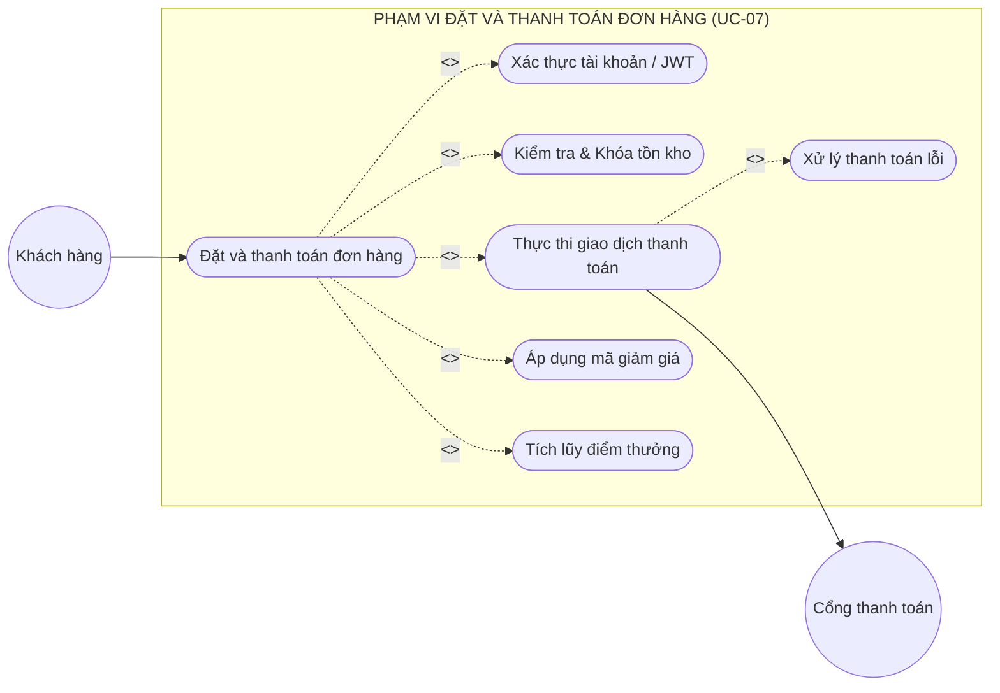

# Đặc Tả Chi Tiết Use-Case Trọng Tâm: Đặt và Thanh Toán Đơn Hàng

| Thuộc tính | Chi tiết |
| :--- | :--- |
| **Tài liệu** | Đặc tả Ca sử dụng Trọng tâm (Core Use-Case Specification) |
| **Mã Use-case** | `UC-07`
| **Tên Use-case** | Đặt và thanh toán đơn hàng (Place Order & Execute Payment) |
| **Dự án** | Hệ thống Đặt và Thanh toán Đồ uống Trực tuyến BrewLite |
| **Người thực hiện** | Nam (Task 1.3) |
| **Mức độ ưu tiên** | **Must Have** |
| **Yêu cầu liên quan** | FR-03, FR-05, FR-06, FR-07, FR-08, FR-09, FR-10, NFR-01, NFR-02, NFR-03 |
| **Tiêu chí nghiệm thu**| AC-05-3, AC-06-1, AC-06-2, AC-07-1, AC-07-2, AC-07-3, AC-07-4, AC-09-1, AC-10-1 |

---

## 1. Mục Tiêu và Tóm Tắt Nghiệp Vụ
Ca sử dụng mô tả chuỗi hành vi nghiệp vụ hoàn chỉnh của hệ thống từ khi Khách hàng hoàn tất việc lựa chọn sản phẩm trong giỏ hàng, xác nhận thông tin đơn, thẩm tra tính sẵn sàng của tồn kho, thực hiện thanh toán trực tuyến không dùng tiền mặt qua Cổng thanh toán mô phỏng, cho đến khi hệ thống cập nhật trạng thái đơn thành công, ghi nhận doanh thu và cộng điểm thưởng thành viên.

---

## 2. Tác Nhân (Actors) và Sự Kiện Kích Hoạt (Trigger)
- **Tác nhân chính (Primary Actor):** Khách hàng (Customer - `ST-01`) – người chủ động khởi tạo và thực hiện thanh toán.
- **Tác nhân hỗ trợ (Secondary Actors):**
  - Cổng thanh toán điện tử mô phỏng (Payment Gateway - `ST-06`): Tác nhân hệ thống ngoài tiếp nhận và phản hồi kết quả giao dịch tài chính.
  - Hệ quản trị CSDL (PostgreSQL): Đảm bảo tính toàn vẹn giao dịch (ACID).
- **Sự kiện kích hoạt (Trigger):** Khách hàng nhấn nút **"Tiến hành đặt hàng"** tại màn hình Giỏ hàng.

---

## 3. Sơ Đồ Use-Case Phạm Vi Đặt và Thanh Toán (Use-Case Diagram)

Sơ đồ mô hình hóa mối quan hệ giữa các hành vi trong phạm vi thanh toán theo chuẩn UML:

*(Mã nguồn PlantUML lưu tại: `docs/diagrams/usecase-checkout.puml`)*.

---

## 4. Các Điều Kiện Ràng Buộc (Pre & Post Conditions)

### 4.1 Tiền điều kiện (Preconditions)
1. Khách hàng đã đăng nhập vào hệ thống và sở hữu mã thông báo JWT (`accessToken`) còn thời hạn hợp lệ.
2. Giỏ hàng của khách hàng có tối thiểu 1 sản phẩm hợp lệ với số lượng $\ge 1$.
3. Các sản phẩm trong giỏ hàng đều đang mở bán (`isAvailable = true`) và số lượng đặt không vượt quá số lượng tồn kho khả dụng tại thời điểm xử lý.
4. Cổng thanh toán mô phỏng đang hoạt động và sẵn sàng tiếp nhận kết nối.

### 4.2 Hậu điều kiện (Postconditions)
- **Khi giao dịch thành công (Success Postcondition):**
  1. Tồn tại bản ghi `Order` với trạng thái chính thức chuyển sang `PAID`, mã đơn dạng `#<chuỗi_duy_nhất>`, tổng tiền khớp đúng với giá trị giỏ hàng sau khuyến mãi.
  2. Số lượng tồn kho (`stock`) của các sản phẩm tương ứng trong bảng `Products` bị trừ chính xác.
  3. Tạo bản ghi `Payment` với trạng thái `SUCCESS` kèm khóa bất biến `Idempotency-Key`.
  4. Điểm thưởng thành viên được cộng dồn theo tỷ lệ: $\text{Điểm} = \lfloor \text{Tổng tiền} / 1000 \rfloor$.
  5. Giỏ hàng trên máy khách được xóa sạch; hệ thống hiển thị màn hình biên nhận kèm mã đơn hàng.
- **Khi giao dịch thất bại (Failure Postcondition):**
  1. Đơn hàng chuyển sang trạng thái `PAYMENT_FAILED` hoặc bị hủy giao dịch.
  2. Toàn bộ số lượng tồn kho đã tạm khóa được hoàn trả nguyên vẹn về kho.
  3. Không có điểm thưởng nào được tích lũy vào tài khoản.
  4. Nội dung giỏ hàng của khách hàng được giữ nguyên vẹn để người dùng có thể thực hiện thanh toán lại.

---

## 5. Dòng Sự Kiện Chính (Basic Flow / Happy Path)

| Bước | Tác nhân thực hiện (Actor Action) | Hệ thống phản hồi (System Response) |
| :---: | :--- | :--- |
| **1** | Khách hàng nhấn **"Tiến hành đặt hàng"** từ màn hình Giỏ hàng. | Kiểm tra tính hợp lệ của JWT Token. Điều hướng sang màn hình Xác nhận thanh toán hiển thị danh sách món, tổng tiền và các lựa chọn phương thức thanh toán (Ví điện tử / Thẻ ngân hàng). |
| **2** | Khách hàng chọn phương thức thanh toán và nhấn nút **"Thanh toán ngay"**. | Phía Client sinh một mã khóa bất biến duy nhất `Idempotency-Key` (UUIDv4) gắn liền với phiên thanh toán này. |
| **3** | | Khởi tạo một **Database Transaction**:  3.1. Thẩm tra tồn kho thời gian thực của từng sản phẩm trong giỏ. 3.2. Giảm trừ số lượng tồn kho tương ứng trong bảng `Products`. 3.3. Tạo bản ghi `Order` ở trạng thái `PENDING` kèm các bản ghi con `OrderItem`. |
| **4** | | Gửi yêu cầu trừ tiền sang Cổng thanh toán (Payment Gateway API) kèm số tiền và `Idempotency-Key`. |
| **5** | | Cổng thanh toán tiếp nhận, xử lý trừ tiền và phản hồi kết quả **THÀNH CÔNG** (HTTP 200). |
| **6** | | Tiếp tục thực thi trong Database Transaction: 6.1. Cập nhật trạng thái `Order` từ `PENDING` sang `PAID`. 6.2. Tạo bản ghi `Payment` với trạng thái `SUCCESS`. 6.3. Tính toán và lưu giao dịch điểm thưởng `LoyaltyTransaction` (loại `EARN`). 6.4. Đóng và xác nhận Transaction (Commit). |
| **7** | | Phía Client xóa toàn bộ dữ liệu giỏ hàng khỏi `localStorage`, điều hướng khách hàng sang màn hình **Biên nhận đơn hàng thành công** hiển thị mã đơn, thời gian và trạng thái `Đã thanh toán`. |
| **8** | Khách hàng kiểm tra mã biên nhận và theo dõi tiến độ chuẩn bị đồ uống. | Ca sử dụng kết thúc thành công. |

---

## 6. Các Dòng Sự Kiện Thay Thế (Alternative Flows)

### Alt-1: Áp dụng Mã khuyến mãi / Voucher giảm giá
- **Điểm kích hoạt:** Tại Bước 1, khách hàng nhập mã voucher vào ô khuyến mãi và nhấn "Áp dụng".
- **Tiến trình xử lý:**
  1. Hệ thống gửi mã voucher lên API thẩm tra tính hợp lệ (thời hạn, giá trị đơn tối thiểu, số lượt còn lại).
  2. Nếu hợp lệ: Tính toán số tiền được chiết khấu theo %, cập nhật lại trường tổng tiền phải thanh toán trên giao diện và ghi nhận mã voucher vào phiên đặt đơn.
  3. Luồng tiếp tục quay trở lại Bước 2 của Luồng chính.

### Alt-2: Khách hàng chưa đăng nhập tài khoản
- **Điểm kích hoạt:** Tại Bước 1, hệ thống phát hiện phiên đăng nhập không tồn tại hoặc Token đã hết hạn.
- **Tiến trình xử lý:**
  1. Hệ thống lưu tạm thời trạng thái giỏ hàng hiện tại vào bộ nhớ đệm trình duyệt.
  2. Hệ thống chuyển hướng khách hàng sang màn hình **Đăng nhập / Đăng ký**.
  3. Sau khi xác thực thành công, hệ thống tự động điều hướng ngược lại màn hình giỏ hàng và tiếp tục thực hiện Bước 1 của Luồng chính.

---

## 7. Các Dòng Sự Kiện Ngoại Lệ (Exceptional Flows)

### Exc-1: Hết hàng hoặc Thiếu hụt tồn kho tại thời điểm đặt (Stock Depleted)
- **Điểm kích hoạt:** Tại Bước 3.1, một hoặc nhiều sản phẩm không đủ số lượng tồn kho khả dụng (do có đơn hàng khác vừa hoàn tất trước đó).
- **Tiến trình xử lý:**
  1. Lập tức hủy bỏ toàn bộ Database Transaction (Rollback).
  2. Trả về mã lỗi HTTP 409 Conflict kèm danh sách sản phẩm bị thiếu hụt.
  3. Giao diện thông báo rõ ràng cho khách hàng món đã hết, giữ nguyên giỏ hàng để khách cập nhật lại số lượng. Ca sử dụng kết thúc an toàn.

### Exc-2: Giao dịch thanh toán bị từ chối hoặc Thất bại (Payment Rejected)
- **Điểm kích hoạt:** Tại Bước 5, Cổng thanh toán phản hồi giao dịch thất bại (số dư không đủ, thẻ bị khóa hoặc kết nối mạng thanh toán gián đoạn).
- **Tiến trình xử lý:**
  1. Hệ thống cập nhật bản ghi `Order` sang trạng thái `PAYMENT_FAILED`.
  2. Hoàn trả lại toàn bộ số lượng tồn kho đã trừ tạm thời ở Bước 3.2.
  3. Tạo bản ghi `Payment` với trạng thái `FAILED` kèm lý do lỗi chi tiết.
  4. Giữ nguyên giỏ hàng của khách hàng, thông báo lỗi trên giao diện và cung cấp nút **"Thử lại"** hoặc cho phép đổi phương thức thanh toán khác.

### Exc-3: Xử lý lặp yêu cầu do gián đoạn mạng hoặc Double-Click (Idempotency Handling)
- **Điểm kích hoạt:** Khách hàng nhấn nút thanh toán nhiều lần hoặc mạng chập chờn gửi lại gói tin mang cùng `Idempotency-Key`.
- **Tiến trình xử lý:**
  1. Tầng Controller kiểm tra thấy `Idempotency-Key` này đã được ghi nhận trong bảng `Payment`.
  2. Hệ thống bỏ qua việc gọi cổng thanh toán lần hai, không trừ tiền hai lần và trả về trực tiếp kết quả giao dịch đã lưu trước đó kèm HTTP 200.